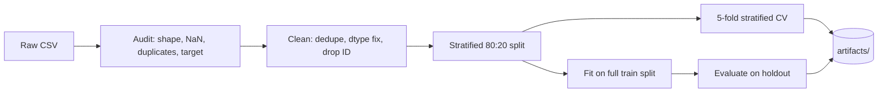

<div align="center">

# 🐱 CatBoost Baseline for Multiclass Classification
### Student Tuition-Fee Category Prediction · GEMASTIK-style Practice Project

**A reproducible, end-to-end CatBoost baseline for imbalanced multiclass tabular data, with native categorical handling, class weighting, stratified cross-validation, and exported artifacts.**

[](https://www.python.org/)
[](https://catboost.ai/)
[](https://jupyter.org/)
[](LICENSE)


[🇬🇧 English version](README_EN.md) · [📓 Notebook](notebooks/catboost_baseline_end_to_end.ipynb) · [🚀 Quick Start](#-quick-start)

</div>

---

> ⚠️ **Dataset notice:** The included CSV is **synthetic practice data**. It is **not** the official GEMASTIK dataset and contains **no real student records**. Results must not be interpreted as performance on real student populations.

## 📑 Table of Contents

- [Why this project](#-why-this-project)
- [Highlights](#-highlights)
- [Project overview](#-project-overview)
- [Results](#-results)
- [Pipeline](#-pipeline)
- [Methodology](#-methodology)
- [Baseline parameters](#-baseline-parameters)
- [Repository structure](#-repository-structure)
- [Quick start](#-quick-start)
- [Limitations and future work](#-limitations-and-future-work)
- [References](#-references)
- [License](#-license)

## 🎯 Why this project

Tabular competition data often mixes categorical and numeric features, has missing values, and has an **imbalanced target**. This repository shows a clean, honest **baseline** for that setting using **CatBoost**, a gradient boosting library designed to handle categorical features natively, so that later experiments (tuning, other models, ensembles) have a reproducible point of comparison.

## ✨ Highlights

- **Native categorical handling**: no one-hot encoding needed; categorical NaNs mapped to `__MISSING__`
- **Class imbalance aware**: `auto_class_weights="Balanced"` and metrics beyond accuracy (Macro F1, Balanced Accuracy, per-class recall)
- **Leak-aware preprocessing**: identifier column (`id_mahasiswa`) excluded from predictors
- **Sound validation**: stratified 80:20 split plus stratified 5-fold CV on the training set
- **Fully reproducible**: fixed seed (`2026`), fixed parameters, `requirements.txt`
- **Exported artifacts**: model, metrics, confusion matrix, feature importance, and predictions
- **Honest reporting**: limitations and evaluation caveats are stated explicitly

## 📋 Project overview

| Item | Description |
|---|---|
| Problem | Multiclass classification |
| Target | `kategori_biaya_kuliah` (tuition-fee category) |
| Algorithm | `CatBoostClassifier` |
| Imbalance strategy | `auto_class_weights="Balanced"` |
| Predictors | 18 features (ID column excluded) |
| Split | Stratified 80:20 train/test |
| Validation | Stratified 5-fold CV on the training set |
| Hyperparameter search | None, this repo intentionally contains only the baseline |
| Metrics | Accuracy, Balanced Accuracy, Macro F1, Weighted F1, per-class recall/F1 |

## 📊 Results

Values below come from the all-feature baseline run recorded during development. Runtime and small numerical differences may vary across environments and package versions.

### Holdout test set (at a glance)

| Accuracy | Balanced Accuracy | Macro F1 | Weighted F1 |
|:---:|:---:|:---:|:---:|
| **0.7000** | **0.6556** | **0.6538** | **0.7023** |

### 5-fold cross-validation (training set)

| Metric | Mean | Std. dev. |
|---|---:|---:|
| Accuracy | 0.6667 | 0.0433 |
| Balanced Accuracy | 0.6210 | 0.0584 |
| Macro F1 | 0.6148 | 0.0467 |
| Weighted F1 | 0.6659 | 0.0468 |

### Per-class recall (holdout)

| Class | Recall |
|:---:|:---:|
| 1 | 0.7500 |
| 2 | 0.4545 |
| 3 | 0.6098 |

Class 2 is the hardest class for this baseline, which makes it a natural target for future work. See the confusion matrix and per-class report in `artifacts/` for error patterns.

> 📝 The test scores are a **development benchmark**, not independent external validation, because this dataset was explored during development.

## 🔄 Pipeline



## 🧪 Methodology

1. Audit dataset dimensions, missing values, duplicates, and target distribution.
2. Remove exact duplicate rows, validate the target, and normalize feature data types.
3. Exclude `id_mahasiswa` from predictors to avoid learning an identifier.
4. Keep categorical features as strings for native CatBoost handling. Missing categorical values become `__MISSING__`; numeric missing values stay as `NaN` for CatBoost to handle.
5. Split data using stratified 80:20 train/test partitioning.
6. Run manual 5-fold CV on training data with a progress bar.
7. Fit one baseline model on the full training split and evaluate on the holdout test set.
8. Export the model, metrics, confusion matrix, feature importance, and predictions to `artifacts/`.

## ⚙️ Baseline parameters

```python
{
    "iterations": 500,
    "depth": 6,
    "learning_rate": 0.05,
    "l2_leaf_reg": 5,
    "loss_function": "MultiClass",
    "eval_metric": "MultiClass",
    "auto_class_weights": "Balanced",
    "random_seed": 2026,
    "verbose": 0,
    "allow_writing_files": False,
    "thread_count": 1,
}
```

No hyperparameter tuning is performed. A fixed baseline is a reproducible point of comparison for later experiments.

## 🗂️ Repository structure

```text
gemastik-catboost-baseline/
├── data/
│   └── dataset_latihan_gemastik_mahasiswa.csv
├── notebooks/
│   └── catboost_baseline_end_to_end.ipynb
├── artifacts/                 # generated locally after running the notebook
├── README.md
├── README_EN.md
├── requirements.txt
├── .gitignore
└── LICENSE
```

## 🚀 Quick start

Python 3.10 or newer is recommended.

```bash
git clone https://github.com/Ihzaanandar/gemastik-catboost-baseline.git
cd gemastik-catboost-baseline
python -m venv .venv
```

Activate the environment:

| OS | Command |
|---|---|
| Windows (PowerShell) | `.venv\Scripts\Activate.ps1` |
| macOS / Linux | `source .venv/bin/activate` |

Install dependencies and launch Jupyter:

```bash
python -m pip install --upgrade pip
pip install -r requirements.txt
jupyter lab
```

Open `notebooks/catboost_baseline_end_to_end.ipynb` and choose **Kernel → Restart Kernel and Run All Cells**. The notebook finds the CSV in the repo root or `data/`, and writes the model and reports to `artifacts/`.

## 🔭 Limitations and future work

**Limitations**

- Synthetic data may not capture real-world tuition-fee patterns.
- The target is imbalanced, so review Macro F1, Balanced Accuracy, and class-level recall rather than Accuracy alone.
- The test set was involved in earlier development decisions, so the reference score is exploratory. Use a newly collected, untouched dataset for independent evaluation.

**Possible next experiments** (outside the scope of this baseline-only notebook)

- [ ] Manually defined class weights and other imbalance strategies
- [ ] Hyperparameter tuning (e.g., Optuna)
- [ ] Model comparison with LightGBM / XGBoost
- [ ] Feature selection and error analysis on class 2

## 📚 References

- Prokhorenkova, L., Gusev, G., Vorobev, A., Dorogush, A. V., & Gulin, A. (2018). *CatBoost: unbiased boosting with categorical features.* Advances in Neural Information Processing Systems 31 (NeurIPS 2018). [arXiv:1706.09516](https://arxiv.org/abs/1706.09516)
- [CatBoost official documentation](https://catboost.ai/docs)

## 📄 License

Code is licensed under the [MIT License](LICENSE). The included synthetic dataset is provided to reproduce this practice project.

---

<div align="center">

**Made by [@Ihzaanandar](https://github.com/Ihzaanandar)** · If this helps your learning, consider giving the repo a ⭐

<sub>Keywords: CatBoost, gradient boosting, multiclass classification, imbalanced data, tabular machine learning, categorical features, class weights, stratified cross-validation, baseline model, GEMASTIK, Python, Jupyter Notebook</sub>

</div>
